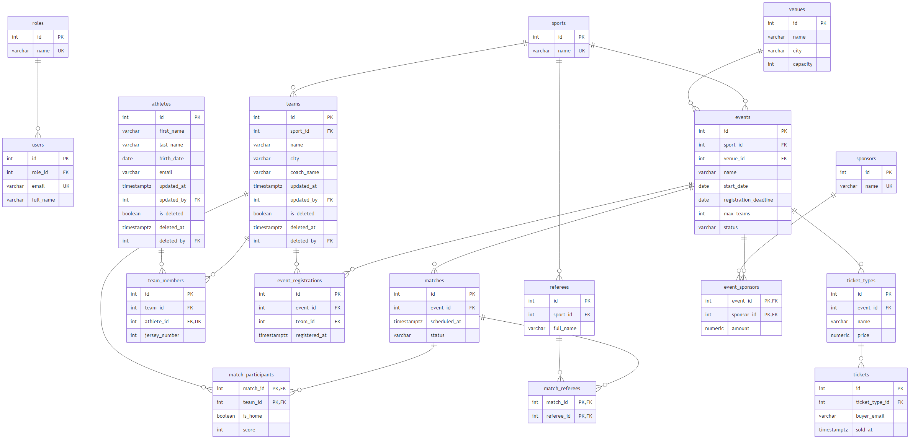

# Лабораторна робота 1 — Система управління спортивними подіями

СУБД: PostgreSQL 17 (Docker). Код: TypeScript (Node.js).

## Запуск

```bash
docker compose up -d --wait
```

```bash
cd app
npm install
npm run demo
```

База: `localhost:55432`, БД `sports_events`, логін/пароль `lab`.

## Що зроблено

**1. Схема БД** — `docs/schema.dbml` (для dbdiagram.io) і `docs/er-diagram.png`.



**2. Сутності** — 17 таблиць (`sql/01_schema.sql`): roles, users, sports, venues, teams, athletes, team_members,
referees, events, event_registrations, matches, match_participants, match_referees, ticket_types, tickets,
sponsors, event_sponsors.

**3. Вимоги, soft delete, аудит** — вимоги в `docs/requirements.md`.
- soft delete: `teams`, `athletes` (поля `is_deleted`, `deleted_at`, `deleted_by`);
- дата і автор останньої зміни: `teams`, `athletes` (поля `updated_at`, `updated_by`, заповнює тригер).

**4. СУБД** — PostgreSQL, скрипти в папці `sql/` запускаються автоматично при старті контейнера.

**5. Процедури, функції, тригери, view** (16 шт.):
- процедури: `sp_team_create`, `sp_team_update`, `sp_team_delete`, `sp_athlete_create`, `sp_athlete_delete`,
  `sp_team_member_add`, `sp_event_register_team`;
- функції: `fn_current_user_id`, `fn_athlete_age`, `fn_event_free_slots`;
- тригери: `trg_fn_set_audit_fields` (аудит), `trg_fn_check_registration` (перевірка заявки на подію);
- view: `v_teams`, `v_athletes`, `v_team_roster`, `v_event_registrations`.

**6. Індекси** (`sql/06_indexes.sql`):
- B-tree: `ix_teams_sport_id`;
- B-tree унікальний частковий: `ux_teams_sport_name_active` (тільки для невидалених команд);
- Hash: `hash_athletes_email`.

**7. Repository + Unit of Work** (`app/src`):
- `BaseRepository` — виклик процедур (`CALL`) і читання з view (`SELECT`);
- репозиторії: `TeamRepository`, `AthleteRepository`, `TeamMemberRepository`;
- `UnitOfWork` — одна транзакція для всіх репозиторіїв, `commit()` / `rollback()`.

`demo.ts` показує: створення команди зі складом в одній транзакції, ROLLBACK при помилці,
аудит змін і soft delete.
